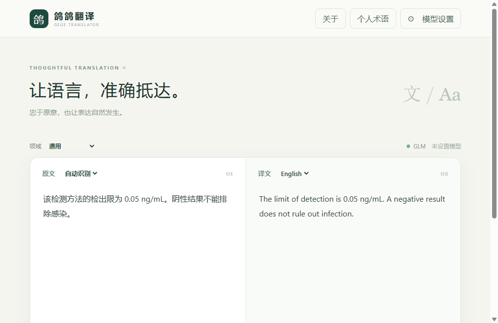
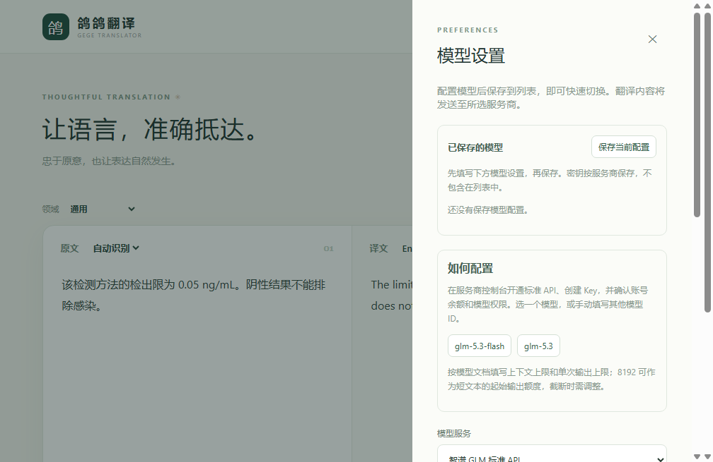
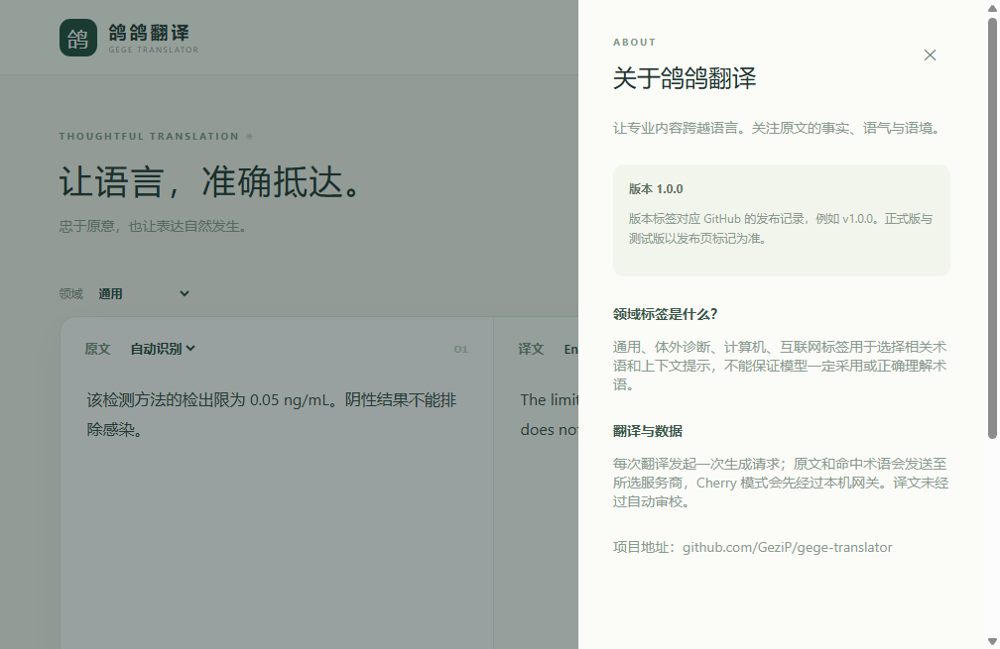

<div align="center">

# 鸽鸽翻译

**让语言，准确抵达。**

专注中英翻译的 Windows 桌面工具，关注专业术语、原文含义与自然表达。

[下载安装](https://github.com/GeziP/gege-translator/releases/latest) · [快速开始](#快速开始) · [模型配置](#模型配置) · [常见问题](#常见问题) · [项目仓库](https://github.com/GeziP/gege-translator)

  

</div>



> 截图使用隔离环境和虚构示例，未使用真实密钥或用户文本。翻译质量取决于模型和原文；重要材料请人工复核。

## 为什么使用鸽鸽翻译？

- **忠实优先**：翻译提示词强调完整、否定关系、条件、数字、单位和原文语气；一次生成，避免额外审校调用。
- **专业语境**：支持通用、IVD、计算机和互联网领域，按原文匹配相关术语，也可维护个人术语。
- **轻量工作流**：粘贴文本、选择语言与领域、翻译、编辑和复制，支持保留 Markdown 结构。
- **模型可选**：支持智谱 GLM 标准 API、DeepSeek，以及实验性的 Cherry Studio 本机网关；可保存多个模型配置并快速切换。
- **密钥分开管理**：个人模型配置不包含密钥；密钥使用系统保护存储，系统保护不可用时只在当次运行中使用。

内置术语目前是少量示例，尚未完成完整的 IVD 专家审核；可使用个人术语补充习惯译法。自动语言识别可能对混合文本判断不准，可手动选择语言。

## 下载安装

前往 [GitHub Releases](https://github.com/GeziP/gege-translator/releases/latest) 下载 `Gege-Translator-*-Windows-x64-Setup.exe`，双击安装并打开“鸽鸽翻译”。安装程序未签名，Windows 可能显示未知发布者提示。

目前仅提供 Windows x64 安装包。升级时继续使用原 `gege-translator` 数据目录，保留已有模型设置、个人术语与加密凭据；建议更新前导出个人术语作为备份。

## 快速开始

1. 点击右上角 **模型设置**，选择服务商，填写模型 ID、上下文上限、输出上限与 API Key；保存密钥，并点击“保存当前配置”以加入模型列表。
2. 粘贴原文，选择目标语言和领域。自动识别有疑问时，请直接手动指定源语言。
3. 点击 **开始翻译**；生成结束后可以直接编辑或复制译文。取消、失败后均需手动重试，不会自动触发额外模型调用。
4. 点击 **个人术语**，添加、编辑、删除或通过 CSV 导入导出；字段和词义适用范围应由使用者确认。



## 模型配置

| 连接方式 | 需要什么 | 使用说明 |
| --- | --- | --- |
| 智谱 GLM 标准 API | 标准 API Key、余额或资源包、可用模型 ID | 选择“智谱 GLM 标准 API”；软件提供模型名称示例，具体权限和价格以智谱控制台为准 |
| DeepSeek | DeepSeek API Key、余额、可用模型 ID | 选择“DeepSeek”；支持示例模型或手动输入 ID |
| Cherry Studio 本机网关（实验） | Cherry Studio、本机网关密钥、网关模型 ID | 先启动 Cherry 的 API 网关，再在软件中保存网关密钥并读取模型列表 |

每个模型可填写上下文上限和输出上限并保存为独立配置；**密钥按服务商保存**，同一服务商的多个模型共用该服务商的 Key。模型目录是配置示例，并不表示你的账户必然具有访问权限。上下文和输出上限应以服务商文档和实际模型为准；`8192` 可作为短文本的起始输出额度。

### GLM Coding Plan 与 Cherry 网关

智谱官方将 Cherry Studio 列入支持工具，但其 FAQ 指出自建应用应使用标准 API；**智谱尚未明确允许自建应用经 Cherry 网关转发使用 Coding Plan**。因此，网关功能为实验性接入，不保证符合套餐使用范围或使用套餐额度。请先向智谱确认，并在控制台费用明细核对实际抵扣来源。[智谱套餐 FAQ](https://docs.bigmodel.cn/cn/coding-plan/faq)

配置路径：

1. 在 Cherry Studio 中配置模型和 Coding Plan Key，按[智谱官方指南](https://docs.bigmodel.cn/cn/coding-plan/tool/others)使用对应编程端点。套餐 Key 留在 Cherry 中。
2. 在 Cherry 的 **设置 → API 网关**启动本机网关，复制其生成的**网关密钥**。默认端口为 `23333`；网关密钥与智谱 Key 是不同凭据。[Cherry 网关说明](https://github.com/CherryHQ/cherry-studio/blob/main/docs/references/api-gateway/README.md)
3. 在鸽鸽翻译中选择 **Cherry Studio 本地网关**，保存网关密钥，读取本地模型列表并选择模型；填写模型上限后保存配置。保持 Cherry Studio 运行。
4. 先用公开短句验证；核对服务商的权限和费用后再决定是否使用。不要把任何 Key 发到聊天、截图或提交到仓库。

软件仅连接本机 `127.0.0.1`，不需要开启 Cherry 的局域网访问。选择本地网关时，原文、背景和命中术语先发给 Cherry，再由 Cherry 发往其配置的模型服务商。

## 领域标签与提示词

领域标签用于选择简短的领域提示和匹配的术语；它不是自动认证，也不保证模型正确。**通用**适合普通文本，**IVD**关注体外诊断术语，**计算机**关注代码与标识符，**互联网**关注产品和运营指标。

每次翻译时，应用将统一的翻译规则作为 `system` 消息，原文和命中术语作为独立的 `user` 数据，发送一次生成请求。直连和 Cherry 网关使用相同的请求构造；自动测试检查三种路径均包含该 system message。Cherry 文档说明其网关会将请求中的 system 指令转入消息处理，但实际服务商是否完全遵循指令仍取决于网关版本和模型，不能保证译文绝对正确。[Cherry 网关参考](https://github.com/CherryHQ/cherry-studio/blob/main/docs/references/api-gateway/README.md)



## 常见问题

**为什么智谱报 429？** 智谱的 429 可能对应余额不足、限流、模型繁忙或其他业务错误。软件会显示可识别的业务码；请以[智谱错误码说明](https://docs.bigmodel.cn/cn/api/api-code)和账户状态为准。Coding Plan Key 不能直接当作标准 API 余额使用。

**为什么没有翻译或提示被截断？** 检查模型 ID、权限、网络、上下文和输出上限；长文本可先缩短。模型可能产生思考 token；一次请求不意味着只有译文 token 被计费。

**CSV 为什么提示以文本导入？** 术语可能以 `=`、`+`、`-` 或 `@` 开头。电子表格软件可能将这些内容视为公式；导出保持原文不变，以便往返导入。

## 开发与验证

```powershell
npm ci
npx install-electron
npm run typecheck
npm test
npm run build
npm run dev
```

需要 Node.js 24。Windows 安装包由 [GitHub Actions](https://github.com/GeziP/gege-translator/actions) 构建，包含自动测试、安装和启动自检。翻译效果尚未完成独立的 IVD 人工盲评，服务商账号、套餐授权与费用也需要用户自行核实。

## 隐私与许可证

原文、背景和命中术语会发送给你选定的模型服务商；不要输入未经授权外发的内容。项目默认不上传遥测，但模型服务商的数据政策独立适用。截图生成使用模拟数据；截图不含真实账号和密钥。

仓库目前未附带开源许可证；源代码的使用授权以仓库所有者明确发布的许可为准。
